# Home Lab Network Monitoring & Intrusion Detection with Snort

An isolated VirtualBox lab where custom Snort rules detect ICMP ping floods and Nmap SYN, NULL, FIN and Xmas scans. Every detection is verified in Wireshark.

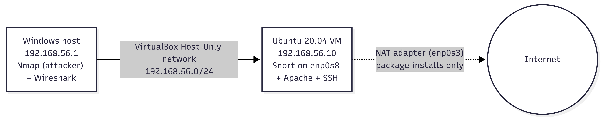

## Lab Setup

| Component | Details |
|---|---|
| Network | VirtualBox host-only network `192.168.56.0/24` |
| Attacker | Windows host, `192.168.56.1` (Nmap, ping) |
| Sensor / target | Ubuntu VM, `192.168.56.10` (Snort) |
| Verification | Wireshark capture of the same traffic |

## Custom Snort Rules

All rules are in [`local.rules`](local.rules).

```
alert icmp any any -> $HOME_NET any (msg:"LAB ICMP flood"; itype:8; detection_filter:track by_src, count 5, seconds 10; sid:1000001; rev:1;)
alert tcp any any -> $HOME_NET any (msg:"LAB TCP SYN scan"; flags:S; detection_filter:track by_src, count 20, seconds 3; sid:1000002; rev:1;)
alert tcp any any -> $HOME_NET any (msg:"LAB TCP NULL scan"; flags:0; sid:1000003; rev:1;)
alert tcp any any -> $HOME_NET any (msg:"LAB TCP FIN scan"; flags:F; sid:1000004; rev:1;)
alert tcp any any -> $HOME_NET any (msg:"LAB TCP Xmas scan"; flags:FPU; sid:1000005; rev:1;)
```

| SID | Detects | Logic |
|---|---|---|
| 1000001 | ICMP flood | Echo requests (`itype:8`), 5 or more from one source within 10 s |
| 1000002 | SYN scan | `SYN` only, 20 or more from one source within 3 s |
| 1000003 | NULL scan | TCP packet with no flags set |
| 1000004 | FIN scan | `FIN` only |
| 1000005 | Xmas scan | `FIN` + `PSH` + `URG` |

SYN and ICMP rules use `detection_filter` because a single SYN or ping is normal traffic. NULL, FIN and Xmas packets are abnormal on their own, so they alert on every packet.

## Results

### ICMP ping flood

The first four pings only triggered Snort's built-in ping rules. From the fifth ping onward, the custom `LAB ICMP flood` rule fired, which matches the threshold of 5 within 10 seconds. Raw alerts: [`Results/alerts_ping.txt`](Results/alerts_ping.txt)

### Nmap scans

Raw alerts: [`Results/alerts_scans.txt`](Results/alerts_scans.txt) (11,986 lines). Full packet capture: [`Results/lab_capture.pcapng`](Results/lab_capture.pcapng).

| Scan | Custom rule alerts | Built-in rule that also fired |
|---|---|---|
| SYN | 1,980 | none |
| NULL | 2,000 | none |
| FIN | 2,000 | `SCAN FIN` (sid 621): 2,000 |
| Xmas | 1,994 | `SCAN nmap XMAS` (sid 1228): 1,994 |

SYN shows 1,980 rather than 2,000, which is consistent with the rule needing 20 SYN packets before it starts alerting. All scan alerts came from `192.168.56.1` to `192.168.56.10`. The few `SNMP` alerts in the file are Snort's built-in rules reacting to probes on the SNMP port, not part of the custom rules.

### Evidence

Each scan was run with Nmap, caught by Snort, and confirmed in Wireshark.

| Scan | Nmap | Snort alert | Wireshark |
|---|---|---|---|
| SYN | 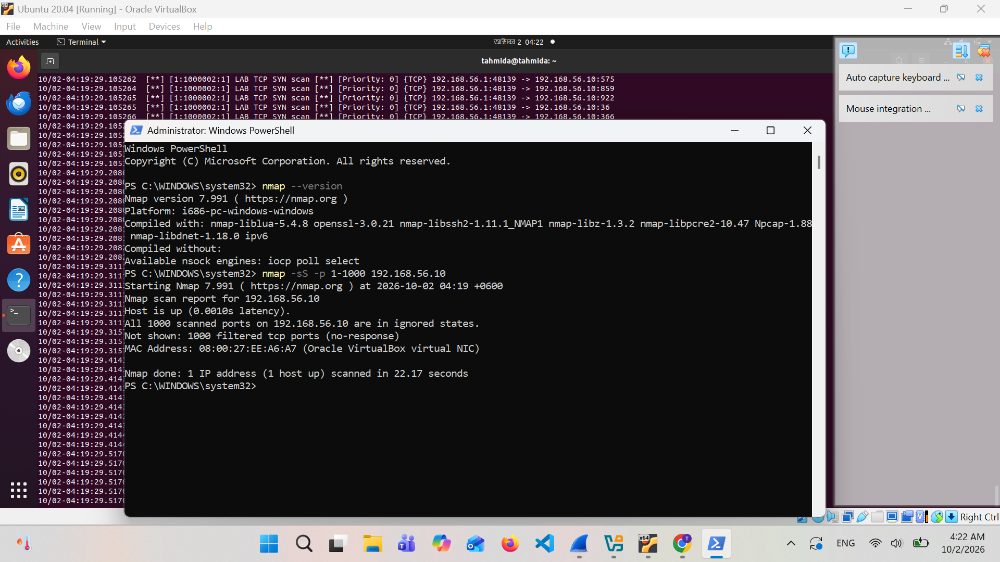 | 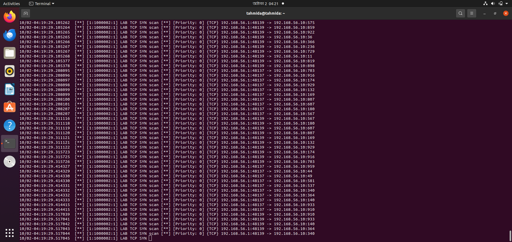 | 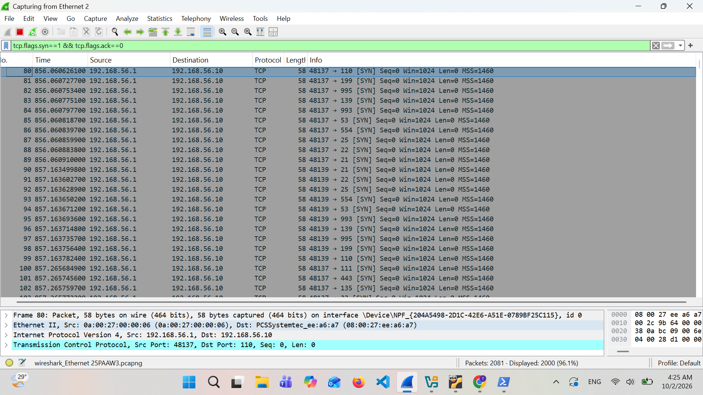 |
| NULL | 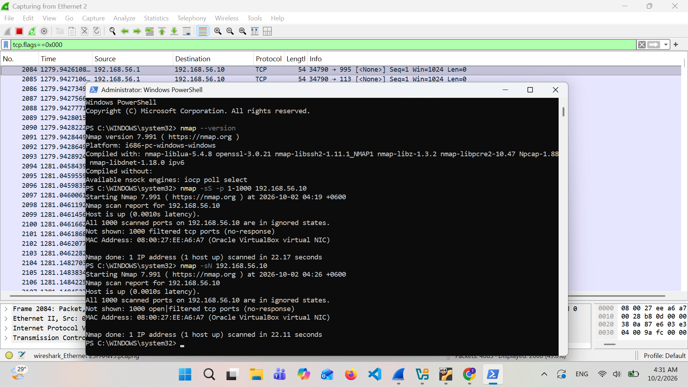 | 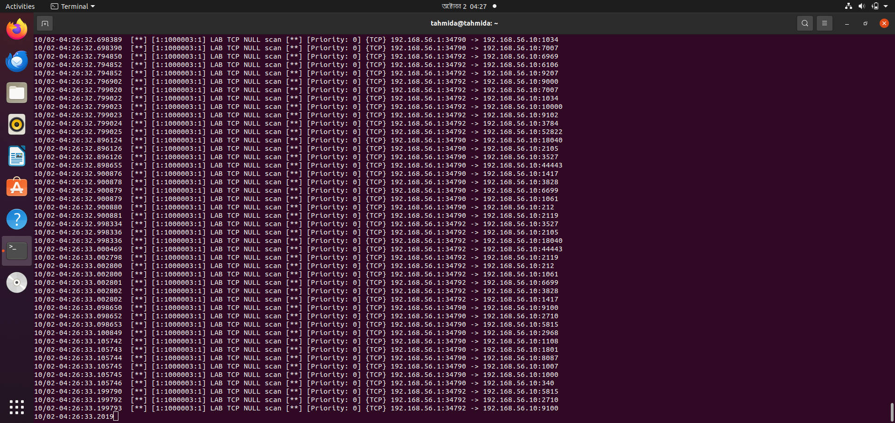 | 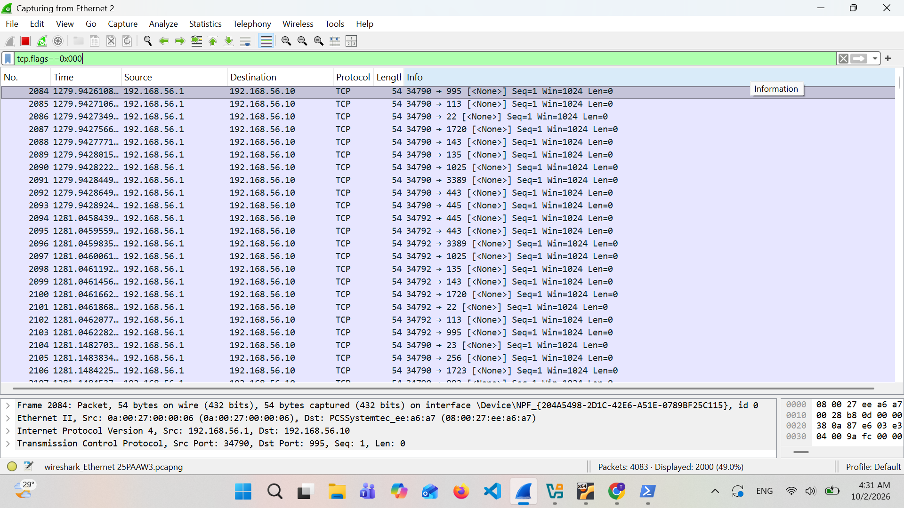 |
| FIN | 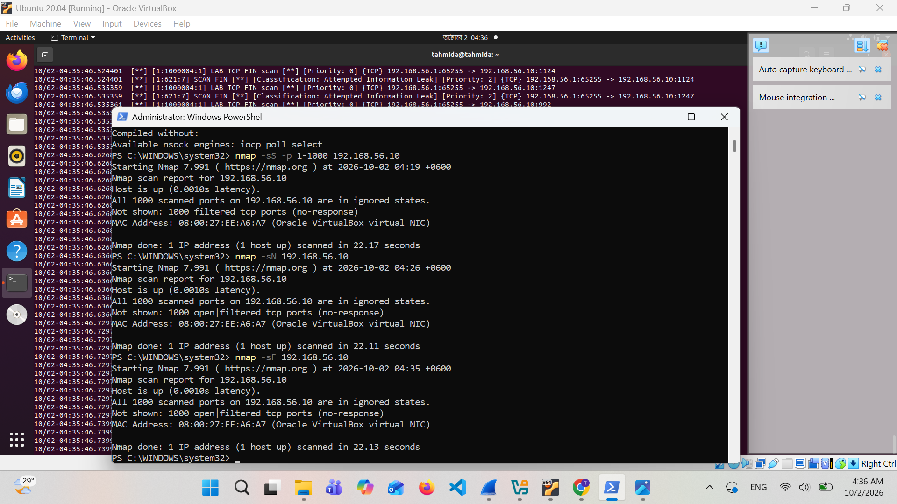 | 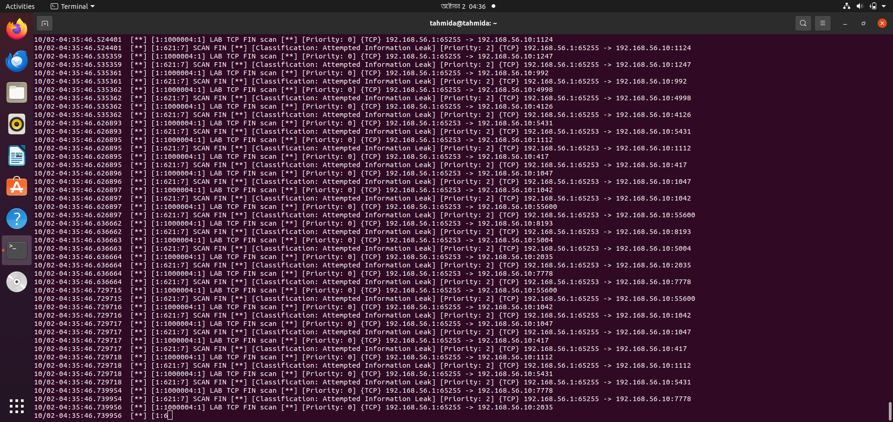 | 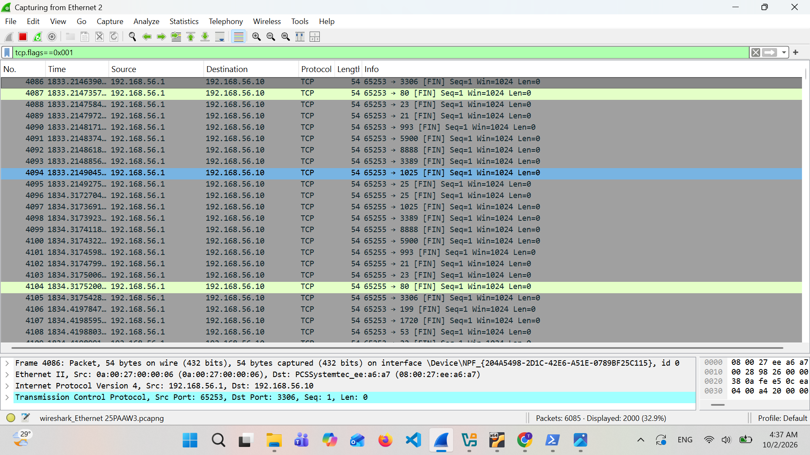 |
| Xmas | 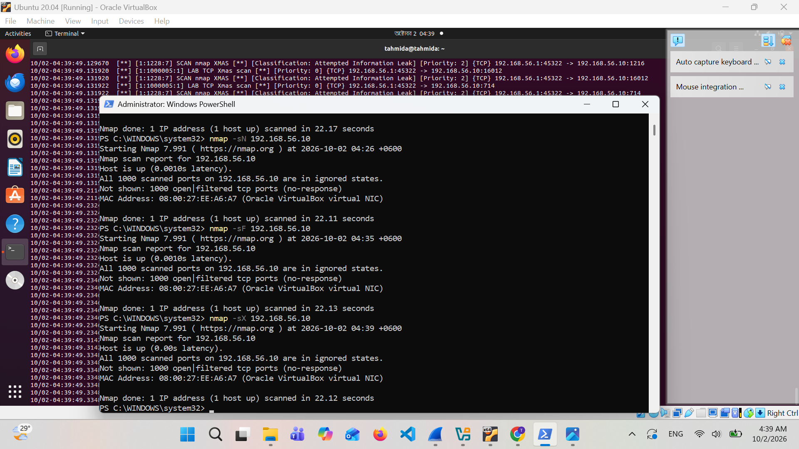 | 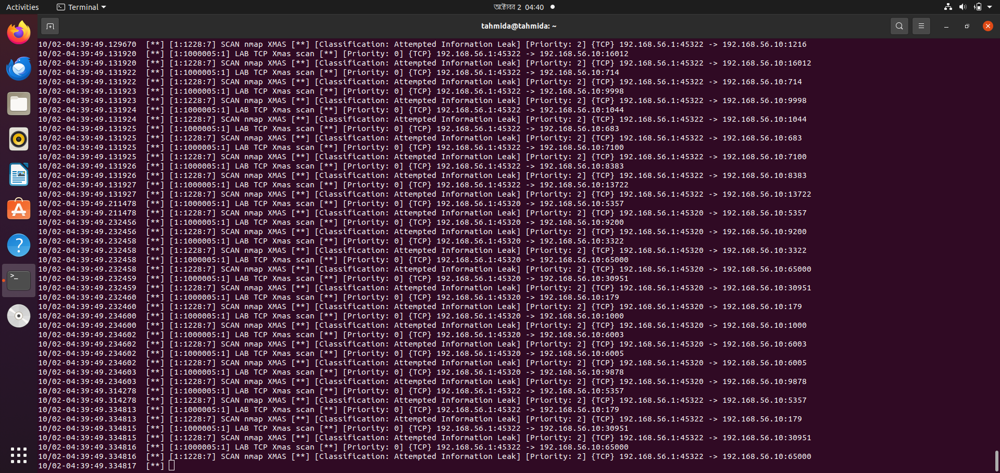 | 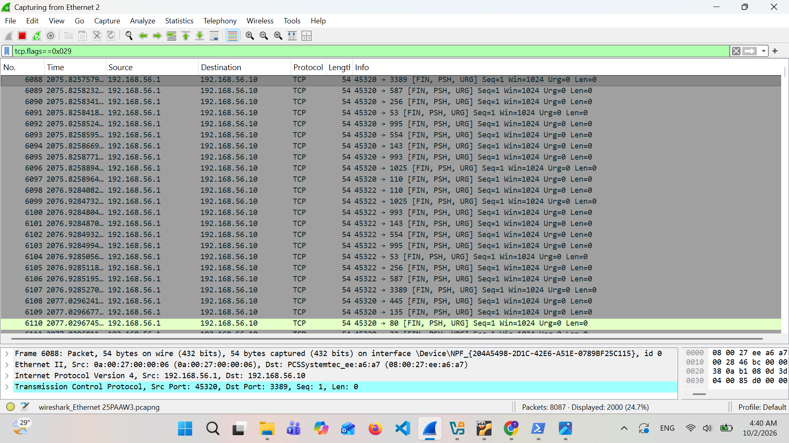 |

Additional FIN scan capture: 

## Repository Contents

| Path | Description |
|---|---|
| [`local.rules`](local.rules) | Custom Snort rules |
| [`Results/alerts_ping.txt`](Results/alerts_ping.txt) | Snort alerts for the ping test |
| [`Results/alerts_scans.txt`](Results/alerts_scans.txt) | Snort alerts for the Nmap scans |
| [`Results/lab_capture.pcapng`](Results/lab_capture.pcapng) | Wireshark capture |
| [`Screenshots/`](Screenshots) | Architecture diagram and per-scan evidence |

## How to Reproduce

1. Create the VirtualBox host-only network and the Ubuntu VM.
2. Copy `local.rules` into the Snort rules directory and include it from `snort.conf`.
3. Run Snort in alert mode on the VM and start a Wireshark capture.
4. From the host, run `ping -t 192.168.56.10`, then Nmap with `-sS`, `-sN`, `-sF` and `-sX` against `192.168.56.10`.
5. Compare the Snort alerts with the Wireshark capture.

## What This Demonstrates

- TCP/IP fundamentals: how scan types differ by TCP flag combination
- Packet analysis in Wireshark
- Writing and tuning custom IDS rules, including threshold-based detection
